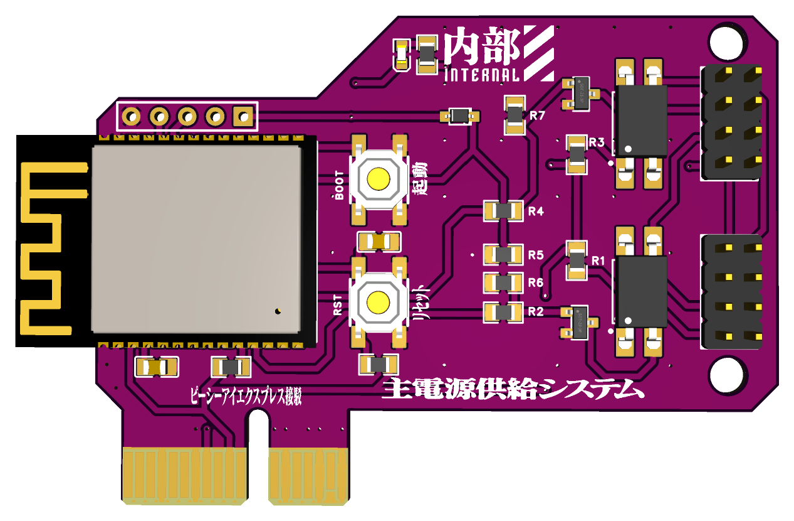
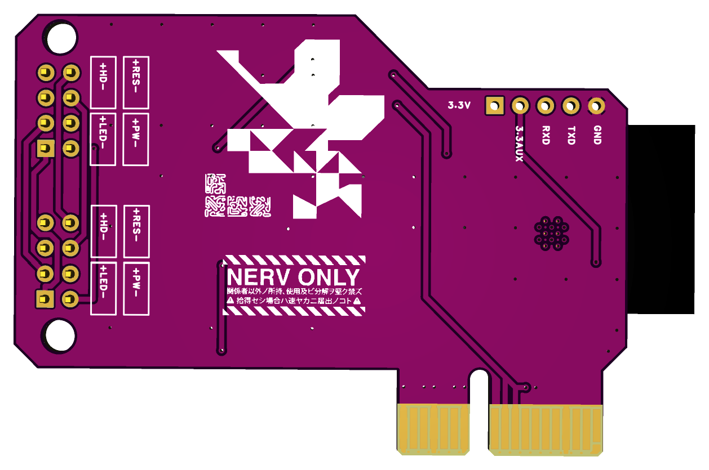
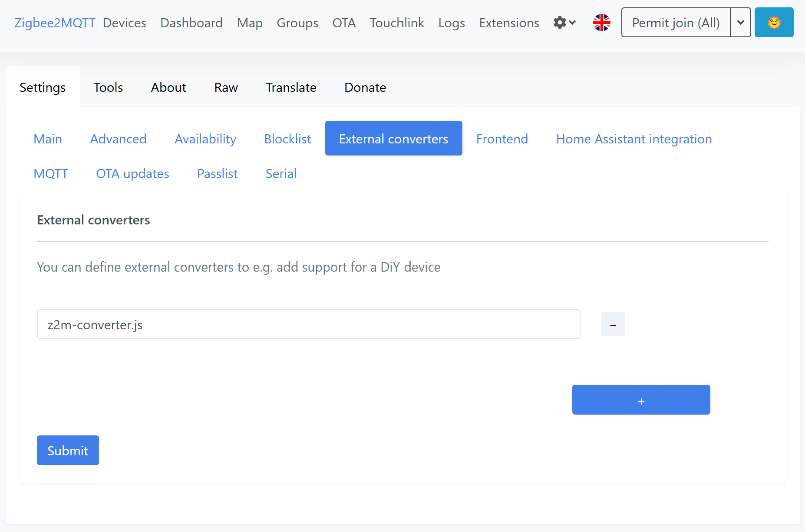

# zigbee-pcie-switch

# Supported Targets

Currently, this example supports the following targets.

| Supported Targets | ESP32-C6 | ESP32-H2 |
| ----------------- | -------- | -------- |

## Hardware

| Front | Back |
| --- | --- |
|  |  |

### Demo

### Flashing from a browser

Connect the switch with a USB data cable and open the [firmware installer](https://yuke-hd.github.io/zigbee-pcie-switch/) in desktop Chrome or Edge. It detects the ESP32-H2 or ESP32-C6 and installs the latest stable GitHub release.

- **Keep pairing** updates an existing switch with the same Zigbee partition layout. It preserves Zigbee pairing and device settings.
- **Wipe** installs a fresh copy of the firmware and clears device settings and pairing. Choose this for a new switch or when you want to pair it again.

If the installer cannot connect, put the board in download mode by holding its BOOT button while resetting or reconnecting USB, then retry.

#### Publishing firmware

Set the repository's **Settings → Pages → Source** to **GitHub Actions**. Publish a stable GitHub release from a tag that includes the firmware workflow. CI builds both chip variants with Arduino-ESP32 3.3.5 and attaches `esp32h2.bin` and `esp32c6.bin` to the release. A separate workflow deploys the browser installer and serves those same binaries over HTTPS.

To redeploy the installer for the current stable release, run **Deploy firmware installer** from the Actions tab on `main`.

#### Using Arduino IDE

To get more information about the Espressif boards see [Espressif Development Kits](https://www.espressif.com/en/products/devkits).

* Before Compile/Verify, select the correct board: `Tools -> Board`.
* Select the End device Zigbee mode: `Tools -> Zigbee mode: Zigbee ED (end device)`
* Select Partition Scheme for Zigbee: `Tools -> Partition Scheme: Zigbee 4MB with spiffs`
* Select the COM port: `Tools -> Port: xxx` where the `xxx` is the detected COM port.
* **Make sure you `esp32` library 3.3.5 installed**

#### Adding the external converter to Zigbee2mqtt
1. Copy the `z2m-converter.js` to your Zigbee2mqtt `data` folder, name the file if needed
2. Open Z2M web ui, go to "Setting -> External converters "
3. Add a new entry with the name of the converter js file

4. Click `Submit`
5. Restart Zigbee2mqtt
   
#### [Z2M 2.0] Adding the external converter to Zigbee2mqtt 
1. Copy the `z2m-converter.js` to your Zigbee2mqtt `data/external_converters` folder, name the file if needed
2. Restart Zigbee2mqtt

## Resources

The ESP Zigbee SDK provides more examples:
* ESP Zigbee SDK Docs: [Link](https://docs.espressif.com/projects/esp-zigbee-sdk)
* ESP Zigbee SDK Repo: [Link](https://github.com/espressif/esp-zigbee-sdk)

* Official ESP32 Forum: [Link](https://esp32.com)
* Arduino-ESP32 Official Repository: [espressif/arduino-esp32](https://github.com/espressif/arduino-esp32)
* ESP32 Datasheet: [Link to datasheet](https://www.espressif.com/sites/default/files/documentation/esp32_datasheet_en.pdf)
* ESP32-S2 Datasheet: [Link to datasheet](https://www.espressif.com/sites/default/files/documentation/esp32-s2_datasheet_en.pdf)
* ESP32-C3 Datasheet: [Link to datasheet](https://www.espressif.com/sites/default/files/documentation/esp32-c3_datasheet_en.pdf)
* ESP32-S3 Datasheet: [Link to datasheet](https://www.espressif.com/sites/default/files/documentation/esp32-s3_datasheet_en.pdf)
* Official ESP-IDF documentation: [ESP-IDF](https://idf.espressif.com)
